# ADR-0017 — Le cycle complet : portes humaines, rôles d'agents

- **Statut** : Accepté (hypothèse à vérifier par l'usage, voir [ADR-0011](0011-versionnement.md))
- **Date** : 2026-11-12
- **Inspirations** : [SFEIR](../inspirations/sfeir-sdlc-ai.md) (capitalisation, rétrospective) ; [AIDD](../inspirations/aidd.md) (apprentissages validés par l'humain) ; [conférences d'Erik S.](../inspirations/anthropic-talks-erik.md) (feuilles et tronc) ; [synthèse](../synthese-des-sources.md), arbitrage A1

## Contexte

L'arbitrage A1 de la synthèse demandait combien de portes humaines poser, et où. La question a été tranchée sur un schéma, repris plus bas, et non sur une liste d'options.

Trois contraintes ont guidé le schéma :

- JDLC couvre tout le cycle de production d'un logiciel, pas seulement le ticket ;
- une porte humaine au milieu de la réalisation ralentit : l'objectif est de produire en masse ;
- chaque rôle doit dire s'il est tenu par un humain ou par un agent, car un humain à une porte n'est pas toujours la même personne ([ADR-0007](0007-concu-pour-l-equipe.md)).

Le schéma a été relu par deux sous-agents : l'un cherchait les contradictions avec les ADR existants, l'autre le confrontait aux pratiques du génie logiciel. Les références citées par le second l'ont été de mémoire et n'ont pas été vérifiées. Leurs constats ont donné seize questions, tranchées par l'auteur le 2026-11-12.

## Options envisagées

1. **Un cycle au niveau du ticket**, avec une porte humaine sur la spec, le plan et la fusion de chaque ticket. Écarté : JDLC ne se limite pas au ticket, et ces portes ralentissent.
2. **Deux portes seulement** : le cadre au début, la pull request à la fin, sans rien entre les deux. Écarté après relecture : aucun humain ne validait ce que chaque ticket devait faire, ce qui contredisait l'[ADR-0009](0009-spec-a-deux-niveaux.md).
3. **Des portes humaines aux changements de niveau** (produit, lot, ticket), et des agents seuls entre elles.

## Décision

**Option 3.**

```mermaid
flowchart LR
  idee(["Idée ou évolution<br/>du produit"])
  court(["Défaut, urgence<br/>ou petite demande"])
  cadrer["1. Cadrer et concevoir<br/>humain et agent"]
  p1{"Porte · humain<br/>Le cadre"}
  prio["2. Prioriser<br/>humain et agent"]
  p2{"Porte · humain<br/>Les priorités"}
  reporte[("Reporté")]
  ecarte[("Écarté")]
  decouper["3. Découper le lot en cours<br/>tickets, critères, profil<br/>agent : garant du cadre"]
  relire["Relire chaque spec de ticket<br/>agent"]
  pd{"Porte · humain<br/>Le découpage du lot"}
  file[("Tickets prêts")]
  plan{"Porte · humain<br/>Le plan, tronc seulement"}
  subgraph ticket ["4. Chaque ticket : des agents seuls, plusieurs tickets à la fois"]
    real["Réalisateur · agent<br/>code, tests, preuve"]
    garant["Garant du cadre · agent<br/>répond avec le cadre"]
    verif["Vérificateur · agent<br/>contexte neuf"]
    ci["Contrôles automatiques<br/>du projet"]
    real --> verif
    verif -- "échec" --> real
    verif -- "conforme" --> ci
    ci -- "échec" --> real
    real -. "question" .-> garant
    garant -. "réponse tirée du cadre" .-> real
  end
  stop{{"Ticket bloqué<br/>question à un humain"}}
  p3{"Porte · humain<br/>Pull request"}
  bilan["Bilan du ticket<br/>agent"]
  lot{{"Lot terminé ?"}}
  livrer["5. Préparer la version<br/>recette du lot, notes de version<br/>agent"]
  p4{"Porte · humain<br/>Publier<br/>selon le projet"}
  retro["6. Rétrospective du lot<br/>humain et agent"]
  amelio[("Règles, mémoire de projet,<br/>issues JDLC")]

  idee --> cadrer --> p1
  p1 -- "validé" --> prio
  p1 -- "à revoir" --> cadrer
  prio --> p2
  p2 -- "retenu, dans l'ordre" --> decouper
  p2 -. "reporté" .-> reporte
  p2 -. "écarté" .-> ecarte
  reporte -. "repris plus tard" .-> prio
  decouper --> relire --> pd
  relire -- "à revoir" --> decouper
  pd -- "validé" --> file
  pd -- "à revoir" --> decouper
  court -- "chemin court,<br/>selon le profil" --> file
  file -- "feuille" --> real
  file -- "tronc" --> plan
  plan -- "validé" --> real
  ci -- "tout passe" --> p3
  p3 -- "corrections" --> real
  p3 -- "fusionnée" --> bilan --> lot
  lot -- "non : il reste des tickets" --> file
  lot -- "oui" --> livrer
  livrer --> p4
  livrer -. "écart avec la spec principale :<br/>nouveaux tickets" .-> decouper
  livrer -. "pas de publication distincte" .-> retro
  p4 -- "publié" --> retro
  retro -- "lot suivant" --> prio
  retro -- "le produit ou le cadre évolue" --> cadrer
  retro -. "améliorations décidées" .-> amelio
  bilan -. "propositions au fil de l'eau" .-> retro
  garant -. "le cadre est muet" .-> stop
  real -. "trois renvois,<br/>ou action irréversible" .-> stop
  stop -- "réponse de l'humain" --> real
  stop -. "le cadre doit changer" .-> cadrer

  classDef hum fill:#ad1f55,stroke:#ad1f55,color:#ffffff
  classDef both fill:#e7eafb,stroke:#3646b5,color:#17212a
  classDef agt fill:#e0f2ee,stroke:#0d7366,color:#17212a
  classDef other fill:#ffffff,stroke:#586675,color:#17212a
  class p1,p2,pd,plan,p3,p4,stop hum
  class cadrer,prio,retro both
  class decouper,relire,real,garant,verif,bilan,livrer agt
  class idee,court,reporte,ecarte,file,ci,lot,amelio other
```

Rouge : un humain décide. Bleu : un humain et un agent travaillent ensemble. Vert : un agent travaille seul. Blanc : ni l'un ni l'autre (entrée, file, outil, test).

### Les étapes

| Étape | Qui | Ce qui s'y passe |
|---|---|---|
| 1. Cadrer et concevoir | Un humain et un agent | L'humain apporte l'idée. L'agent le questionne et rédige la spec principale, la conception et les exigences de qualité ([ADR-0018](0018-exigences-de-qualite.md)), dans un format exploitable par les agents. |
| 2. Prioriser | Un humain et un agent | L'agent prépare la décision pour chaque fonctionnalité : son apport, son coût, ses dépendances. |
| 3. Découper le lot en cours | Un agent | Le garant du cadre découpe en tickets les fonctionnalités du lot en cours, et seulement celles-là. Chaque ticket reçoit sa spec, ses critères d'acceptation et son profil ([ADR-0014](0014-profils-de-travail.md)). Un autre agent relit chaque spec de ticket. |
| 4. Réaliser les tickets | Des agents | Plusieurs tickets à la fois. Chaque ticket est réalisé, vérifié par un agent sans le contexte du premier, puis passe les contrôles automatiques du projet. |
| 5. Préparer la version | Un agent | Recette du lot entier contre les critères de succès de la spec principale. Un écart devient un nouveau ticket. |
| 6. Rétrospective du lot | Un humain et un agent, et l'équipe humaine s'il y en a une | Le produit, le cadre, le processus. Il en sort des règles et des apprentissages pour le projet, des issues pour JDLC, des évolutions du cadre. |

### Les portes humaines

| Porte | Fréquence | Ce qu'un humain décide |
|---|---|---|
| Le cadre | Une fois, puis à chaque évolution du produit | Ce qu'on construit, et sur quelle architecture |
| Les priorités | Après le cadre, puis à chaque lot | Ce qui est implémenté, reporté ou écarté, et dans quel ordre. Cet ordre fixe les lots. |
| Le découpage du lot | Une fois par lot | Les tickets, leurs critères d'acceptation, leur profil |
| Le plan | À chaque ticket du tronc | La façon de modifier le tronc ([ADR-0016](0016-comprendre-le-tronc.md)). Une feuille n'a pas cette porte. |
| La pull request | À chaque ticket | Le résultat. Sur le tronc, l'humain comprend aussi le code. Sur une feuille, la preuve suffit. |
| Publier | Une fois par lot, selon le projet | La publication, quand elle est un acte distinct de la fusion |

Un ticket bloqué est le seul arrêt imprévu : un humain y répond à la question que le cadre ne tranche pas.

### Les rôles d'agents pendant la réalisation

- **Garant du cadre (agent).** Il découpe le lot et écrit la spec de chaque ticket à partir du cadre validé. Pendant la réalisation, il répond aux questions du réalisateur en s'appuyant sur le cadre. Il ne juge pas le résultat. Si le cadre est muet ou devrait changer, il ne tranche pas : le ticket passe à l'état « bloqué ».
- **Réalisateur (agent).** Il planifie, code et teste. Chaque tâche finie joint sa preuve.
- **Vérificateur (agent).** Il n'a pas le contexte du réalisateur. Il contrôle le résultat contre la spec du ticket et contre le cadre.

### Les réglages retenus

- **Tests d'acceptation.** Ils sont écrits par un autre agent que le réalisateur, à partir des critères d'acceptation. Le réalisateur ne peut pas les modifier. Il garde ses tests unitaires.
- **Départ supervisé** ([ADR-0012](0012-autonomie-gagnee.md)). Sur le premier ticket d'un projet ou d'un lot, le réalisateur s'arrête à chaque étape devant un humain. Si ce ticket est propre, les agents font les suivants seuls.
- **Ticket bloqué.** Un agent s'arrête et interroge un humain après trois renvois de suite du vérificateur vers le réalisateur, ou avant une action irréversible. Les autres tickets continuent.
- **Pas de limite au nombre de pull requests en attente.** L'objectif est de produire en masse. Passé un certain nombre de pull requests à valider, JDLC propose à l'humain un skill qui l'aide à les trier, à les traiter dans un ordre utile et à voir si elles peuvent être validées par lots.
- **Entrée courte.** Un défaut, une urgence ou une petite demande devient un ticket et entre directement dans la file, sans repasser par le cadre ni par les priorités. Un agent propose son profil, un humain le confirme à la création du ticket. Le ticket assure le suivi.
- **Une rétrospective par lot, et des propositions au fil de l'eau.** Un agent peut proposer une amélioration dès le bilan d'un ticket. Ces propositions alimentent la rétrospective. Les règles et la mémoire de projet ne changent que sur validation humaine ([ADR-0013](0013-validation-humaine-regles-memoire.md)).
- **Premier lot.** Il construit un squelette qui traverse toute l'architecture, pour qu'un humain voie la conception fonctionner avant que les agents ne construisent dessus.
- **Humains aux portes.** JDLC propose pour chaque porte des profils humains types (responsable de produit, designer, développeur, ou tout autre archétype), pour aider à trouver la bonne compétence quand c'est possible.
- **Indicateurs** ([ADR-0015](0015-mesure-minimale.md)). Trois : la part des pull requests qu'un humain fait corriger, le temps d'attente d'une pull request avant sa relecture par un humain, les défauts trouvés après fusion.
- **Première implémentation** ([ADR-0011](0011-versionnement.md)). La 0.1.0 outille d'abord les étapes où des agents travaillent seuls : découpage, réalisation, vérification, bilan. Le cadrage et la rétrospective se font d'abord sans outillage JDLC.

## Conséquences

- L'arbitrage A1 est clos. Le principe 6 et le périmètre de la [vision](../vision.md) sont mis à jour.
- La décision respecte l'[ADR-0009](0009-spec-a-deux-niveaux.md) : un humain valide les critères d'acceptation avant la construction, en une fois par lot.
- **Le risque assumé est l'accumulation de pull requests** devant un humain, puisqu'aucune limite n'est posée. Le skill de tri est la réponse prévue. Le temps d'attente d'une pull request est mesuré pour le vérifier.
- Restent à concevoir ou à vérifier :
  - la **conception** : ce qu'est cet artefact et où il vit. Aucun ADR ne le dit encore ;
  - quel agent relit les specs de tickets, et quel agent écrit les tests d'acceptation ;
  - le dialogue entre le réalisateur et le garant du cadre : à vérifier dans la documentation de Claude Code au moment de construire ;
  - la liste des actions irréversibles ;
  - les profils humains types de chaque porte ;
  - le skill de tri des pull requests, et le seuil à partir duquel il est proposé ;
  - le lien entre ces étapes et les états du ticket ([ADR-0008](0008-ticket-unite-de-travail.md)).
- **Non tranché, à déterminer par l'usage :** ce que deviennent les tickets en cours quand un humain change le cadre en cours de lot, et le versionnement du cadre.
- Les contrôles automatiques (intégration continue, analyse statique, détection de secrets) appartiennent au projet cible. JDLC conseille au moment du cadre, puis garantit les règles retenues pendant la réalisation ([ADR-0018](0018-exigences-de-qualite.md)).
