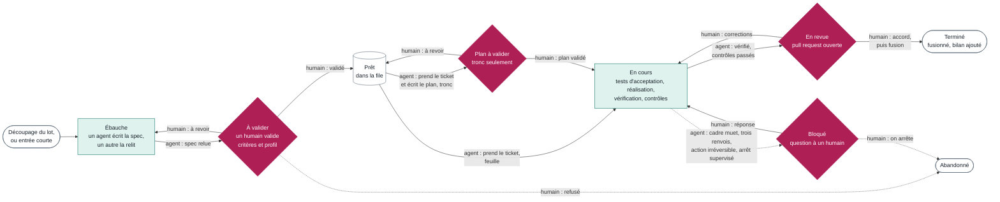

# ADR-0019 — Le ticket : ses états, ses portes, son gabarit

- **Statut** : Accepté (hypothèse à vérifier par l'usage, voir [ADR-0011](0011-versionnement.md))
- **Date** : 2026-11-12, complété le 2026-11-13 après une relecture de cohérence
- **Inspirations** : méthodes agiles (Kanban, Scrum), et développement piloté par les tests (*test-driven development*), d'après la connaissance générale qu'on en a : ces méthodes n'ont pas encore été étudiées comme sources, et rien n'en est importé.

## Contexte

L'[ADR-0008](0008-ticket-unite-de-travail.md) a fait du ticket l'unité de travail, et a laissé deux questions ouvertes : les états du ticket sont-ils les étapes du cycle, et les portes humaines sont-elles des changements d'état ? L'[ADR-0017](0017-cycle-complet.md) a depuis fixé le cycle. Il faut maintenant dire comment ce cycle se lit dans un ticket, car c'est le socle de la première implémentation.

## Options envisagées

1. **Les états du ticket reprennent les étapes du cycle.** Écarté : le cycle a trois niveaux (produit, lot, ticket), et un ticket ne vit que dans deux de ses étapes.
2. **Un état par agent qui intervient** (réalisation, vérification, contrôles). Écarté : hors départ supervisé, aucun humain n'agit pendant ces étapes, et beaucoup d'états se traduisent mal d'un outil de tickets à l'autre.
3. **Peu d'états, qui disent qui doit agir**, et des portes qui sont des changements d'état réservés à un humain.

## Décision

**Option 3.**

### Les états

Rouge : un humain doit agir. Vert : un agent travaille. Blanc : personne n'agit.

| État | Qui doit agir |
|---|---|
| Ébauche | Un agent écrit la spec du ticket, un autre agent la relit |
| À valider | Un humain valide les critères d'acceptation et le profil |
| Prêt | Personne : le ticket attend dans la file |
| Plan à valider | Un humain. Cet état n'existe que pour un ticket du tronc. |
| En cours | Des agents : tests d'acceptation, réalisation, vérification, contrôles automatiques |
| Bloqué | Un humain répond à la question posée par un agent |
| En revue | Un humain, à la pull request |
| Terminé | Personne. Un agent y ajoute le bilan juste après la fusion. |
| Abandonné | Personne |

- **« En cours » est un seul état.** Un champ du ticket dit l'étape : tests d'acceptation, réalisation, vérification, contrôles.
- **Les tests d'acceptation viennent en premier**, avant la réalisation, sur le modèle du développement piloté par les tests. Un autre agent que le réalisateur les écrit à partir des critères d'acceptation, et le réalisateur ne peut pas les modifier ([ADR-0017](0017-cycle-complet.md)).
- **L'entrée courte suit le même chemin.** Un ticket créé pour un défaut, une urgence ou une petite demande passe par « ébauche » puis « à valider », où un humain valide d'un geste ses critères et son profil. Il ne repasse ni par le cadre ni par les priorités.
- **Le départ supervisé utilise l'état « bloqué ».** Sur le premier ticket d'un projet ou d'un lot ([ADR-0012](0012-autonomie-gagnee.md)), l'agent réalisateur passe le ticket à « bloqué » à la fin de chaque étape, avec la question « étape finie, je continue ? ».
- **Les états du ticket ne sont pas les étapes du cycle.** Un ticket ne vit que dans les étapes « découper » et « réaliser ». Le cadrage, la priorisation, la préparation de la version et la rétrospective se passent au-dessus de lui.

### Les portes

- **Une porte humaine est un changement d'état qui demande la décision d'un humain.** Un agent amène le ticket dans un des quatre états rouges, et ne l'en sort que sur une décision tracée d'un humain. L'humain fait le geste lui-même, ou le demande à un agent qui l'exécute et met les états à jour. C'est une règle que JDLC garantit, pas seulement une consigne.
- **La fusion suit cette règle.** Elle peut être déclenchée par une demande humaine et exécutée par un agent. La fusion passe le ticket à « terminé », et l'agent y ajoute le bilan.
- **La validation du découpage se fait au choix de l'humain :**
  - ticket par ticket, dans l'interface de l'outil de tickets ou dans la conversation avec un agent ;
  - ou pour tout un lot d'un coup, en le disant à un agent, qui passe alors les tickets du lot à « prêt ».
- **Après la validation humaine, un agent ne change pas un critère d'acceptation.** Si un changement est nécessaire, il repasse par un humain.
- Les portes du cadre, des priorités et de la publication ne passent pas par le ticket.

### Les niveaux

| Niveau | Ce que c'est | Représentation générique |
|---|---|---|
| Produit | Le cadre : spec principale, conception, exigences de qualité | Trois fichiers et des décisions ([ADR-0020](0020-le-cadre-comme-artefact.md)) |
| Lot | Les fonctionnalités retenues pour une version | Un regroupement propre à l'outil de tickets |
| Fonctionnalité | La spec partagée de plusieurs tickets | Un ticket parent ([ADR-0009](0009-spec-a-deux-niveaux.md)) |
| Ticket | L'unité de travail d'un agent réalisateur | Un ticket |

- Tout cela relève du **projet**, pas de l'instance. Seules les notes de session d'un agent restent locales.
- Le skill de chaque outil de tickets précise au mieux l'adaptation à cet outil. Dans GitHub, un lot est un jalon.
- **Reporter un ticket prêt est un changement de planification** : il reste « prêt » et change de lot. La priorité induit la planification, il n'y a pas d'état « reporté ».

### Le gabarit

**Écrit au découpage, par un agent :**

- titre ;
- type : fonctionnalité, défaut, urgence, tâche technique ;
- parent : la fonctionnalité et le lot ;
- intention : pourquoi, avec un renvoi à la spec principale, sans la recopier ;
- critères d'acceptation, chacun avec sa méthode de vérification ;
- ce qui ne doit pas changer ;
- hors périmètre ;
- dépendances : les tickets à finir avant ;
- exigences de qualité qui s'appliquent, par renvoi au cadre ;
- profil proposé : feuille ou tronc, niveau de risque ([ADR-0014](0014-profils-de-travail.md)).

**Validé par un humain :**

- les critères d'acceptation ;
- le profil ;
- le nom de l'humain et la date, pour la trace.

**Rempli pendant le travail, par des agents :**

- preneur : l'instance qui tient le ticket, une seule à la fois ([ADR-0008](0008-ticket-unite-de-travail.md)). Tous les agents de cette instance écrivent sous ce verrou ;
- étape en cours ;
- lien vers les tests d'acceptation ;
- plan, pour le tronc ;
- questions à un humain, et ses réponses ;
- changements de spec, chacun avec sa raison ;
- lien vers la pull request et la preuve.

**Écrit à la fin, par un agent :**

- bilan : ce qui a coincé, ce qu'un humain a fait corriger ;
- propositions d'amélioration, marquées pour la rétrospective.

### Le premier outil

**GitHub** est le premier outil de tickets pris en charge. La pull request y vit déjà. **GitLab** sera sûrement le second.

## Conséquences

- Les deux questions ouvertes de l'ADR-0008 sont closes.
- Le stockage des tickets dans des fichiers du dépôt, défaut prévu par l'ADR-0008 quand il n'y a pas d'outil, n'est pas dans la première implémentation.
- Restent à concevoir :
  - la façon de garantir qu'un agent ne franchit pas une porte sans décision humaine. Elle dépend de l'outil : droits, hooks, ou contrôle par un autre agent ;
  - la traduction des neuf états dans GitHub (étiquettes, champs de projet, état ouvert ou fermé) ;
  - la trace de la validation humaine quand elle est donnée dans la conversation avec un agent ;
  - le format exact du gabarit, et la part lisible par une machine ;
  - les états du lot.
- Kanban et Scrum restent à étudier comme sources. Cette décision pourra être précisée après.
